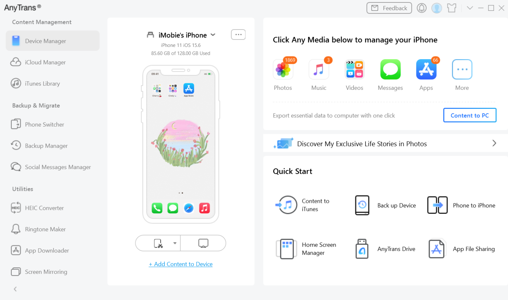
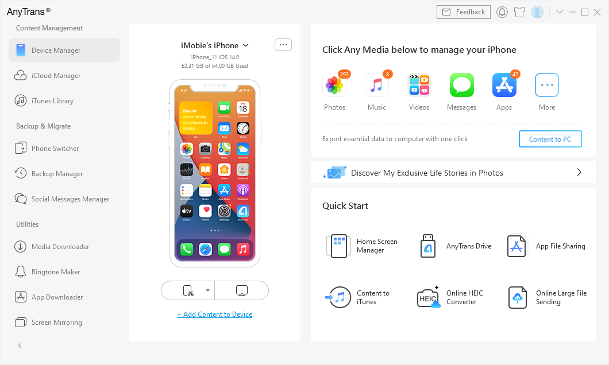

# AnyTrans Moves Your Mobile Library Between Devices

AnyTrans brings iPhone media, personal data, device migration, and backups into a desktop workspace.
A useful transfer begins with a clear direction: which device supplies the content, and where the result should appear.
Use this guide to plan a selected handoff or a broader move to another iPhone.

[](https://anytrans-windows.github.io/Imobie-Anytrans/)

## Follow the Direction of the Transfer

Choose the operation before selecting files.
Exporting a photo to a computer, adding a song to a phone, and restoring a backup have different destinations.
The [AnyTrans guide index](https://www.imobie.com/anytrans/guide.htm) separates these workflows.

| Operation | Source | Destination | Where to work in AnyTrans |
| --- | --- | --- | --- |
| Keep selected phone photos on the computer | Connected iPhone or iPad | Desktop folder | Photos |
| Add a local music selection | Computer | Connected iOS device | Music |
| Move supported categories to another iPhone | Old Android or iOS device | Target iPhone | Phone Switcher |
| Preserve a device snapshot | Connected iOS device | Computer backup location | Backup Manager |
| Keep supported chat data separately | Supported messaging app on the phone | Social-message backup | Social Messages Manager |

Check the displayed device name whenever more than one phone is connected.
For **AnyTrans Windows**, complete the iOS device-support requirements described in the relevant official guide.
Device detection and category access are separate checkpoints.

For a technical explanation of the open-source device stack, read [understanding_idevice_protocol_layers.md](misc/understanding_idevice_protocol_layers.md).
The pymobiledevice3 package identity and Python requirements are declared in [pyproject.toml](pyproject.toml).

## Give a Photo Collection a Destination

In AnyTrans, open **Photos > My Photos**, allow the category to load, and choose a small selection.
Use **To PC** for a computer export or **To Device** for another connected iOS device.
The [photo-management instructions](https://www.imobie.com/guide/anytrans/my-photos-management.htm) explain these actions.

For a trip archive, create a destination around the event rather than the current phone name.
That folder can remain meaningful after the phone is replaced.
Keep the exported originals separate from versions prepared for email or document sharing.



Before exporting a large collection:

- Confirm that the selection belongs to the intended device.
- Include videos when the event contains both photos and clips.
- Open representative exported images at normal viewing size.
- Check dates and orientation in the application that will use them.
- Keep source copies until the desktop collection is usable.

AnyTrans also provides an image-conversion tool for formats listed in its current interface.
Choose conversion for a compatibility requirement, and retain an original copy when image characteristics matter.
Converting an image and moving it to another device are different operations.

### Copy an accessible camera folder with pymobiledevice3

For a separate file-oriented workflow, pymobiledevice3 can pull a directory exposed through AFC.
This example assumes the tool and platform prerequisites are installed, one trusted iPhone is connected, DCIM is accessible, and the destination is new.

```bash
pymobiledevice3 afc pull DCIM "./camera-roll-copy"
```

The [AFC reference](https://doronz88.github.io/pymobiledevice3/latest/cli/afc/) documents the source and destination arguments.
AFC exposes a permitted media area; its directory view is different from AnyTrans's organized photo categories.
It does not imply access to every application container.

For protocol research, [usbmux_sniff.sh](misc/usbmux_sniff.sh) intercepts a local usbmux socket, while [plist_sniffer.py](misc/plist_sniffer.py) parses property-list payloads in captured traffic.
These scripts help explain transport behavior and are unnecessary for an ordinary AnyTrans photo export.

## Keep Music Files and Playlist Order Together

AnyTrans's Music section can transfer selected songs to a computer, another device, or the iTunes library.
Use the [Songs guide](https://www.imobie.com/guide/anytrans/songs-management.htm) for the available transfer actions.
The source library, the exported audio files, and a playlist are related but distinct.

For a music handoff, decide whether you need:

- A few playable tracks.
- An album with its track sequence.
- A playlist with its chosen order.
- A desktop copy of an existing device library.

Open a sample of the exported audio before transferring the entire selection again.
Protected media can have playback restrictions; copying a file does not remove them.
Check the actual files and playback application you intend to use.

### Create a desktop listening list from exported MP3 files

The following Python example creates an alphabetically sorted M3U8 list inside an existing export folder.
It assumes the folder contains MP3 files and that the playlist name is unused.

```python
from pathlib import Path

music = Path("exported-music")
tracks = sorted(p.relative_to(music).as_posix() for p in music.rglob("*.mp3"))
playlist = music / "desktop-listening.m3u8"
with playlist.open("x", encoding="utf-8") as output:
    output.write("#EXTM3U\n" + "\n".join(tracks) + "\n")
```

Open the list in a desktop player that supports UTF-8 M3U playlists.
Keep it beside the exported music so that the relative paths continue to resolve.
This creates a new alphabetical list; preserve an original playlist separately when its curated order matters.

## Move to Another iPhone in Deliberate Passes

Use **Phone Switcher > Phone to iPhone** when the goal is a device migration.
AnyTrans documents Android-to-iPhone and iOS-to-iPhone sources in its [migration guide](https://www.imobie.com/guide/anytrans/phone-to-iphone.htm).
The destination for that workflow is an iOS device.

### Confirm the roles before choosing categories

Keep the old phone connected as the source and identify the target iPhone explicitly.
For an Android source, follow the guide's USB debugging and driver requirements.
For an iPhone source, complete the required device authorization.

Choose the categories offered for the actual device pair.
Do not infer that every supported category transfers in both directions or between every application.
A successful photo transfer is not proof that a chat migration has also completed.



After the transfer, inspect the target in its own applications:

1. Open several photos and a video.
2. Check a contact with more than one field.
3. Review the date range of transferred messages where supported.
4. Open important applications and confirm any required sign-in.
5. Keep the old phone available while resolving missing categories.

For background on newer device communication, [RemoteXPC.md](misc/RemoteXPC.md) describes the transport and pairing model.
The associated research utility is [remotexpc_sniffer.py](misc/remotexpc_sniffer.py).
Historical developer-service listings are supplied in [DTServices-14.2.txt](misc/DTServices-14.2.txt) and [DTServices-14.5.txt](misc/DTServices-14.5.txt).
Those listings describe service interfaces, not a guarantee that an app's data can be migrated.

## Make Backups Serve a Different Purpose from Exports

An export gives you selected files to use now.
A backup preserves supported device data for later review or restoration.
Use both when the task requires a working desktop collection and a separate device snapshot.

The [Backup Manager guide](https://www.imobie.com/guide/anytrans/back-up.htm) describes full, incremental, and Air Backup modes.
Full backup establishes a snapshot, while incremental backup copies changes since the preceding backup.
Air Backup adds scheduling when the device and computer are connected to the same Wi-Fi.

Choose a backup location you can identify later.
If encryption is enabled, retain the password needed to use that backup.
After completion, check the recorded device, date, and result rather than assuming a schedule has run.

For recurring backups, verify the conditions that make the schedule useful:

- The computer is available at the planned time.
- The phone can connect on the expected network.
- The destination has space for the backup history.
- The latest completed entry is recent enough for your needs.

### Keep social-message backups recognizable

Use Social Messages Manager for the messaging applications supported by the current workflow.
The [social-message backup guide](https://www.imobie.com/guide/anytrans/back-up-social-messages.htm) covers WhatsApp, LINE, and Viber.
Identify the application and device when choosing or reviewing a backup.

A chat backup, a readable conversation export, and a transfer into another phone's app are different results.
Select the operation that produces the result you need.
Review attachments and the useful date range when checking the outcome.

## Share an Export or Present the Phone Screen

Once a selected export is on the computer, it can become a normal file handoff.
For nearby devices running LocalSend on the same network, its CLI can send a prepared folder and document.
This example assumes both paths exist and the receiving device is available.

```bash
localsend-cli send "./trip-share" "./trip-notes.pdf"
```

Choose the destination from the discovered-device list.
The [LocalSend CLI instructions](https://github.com/localsend/localsend#command-line-interface) explain this interactive selection.
The receiving application still determines how the transferred files are opened or imported.

For a live demonstration, AnyTrans also provides Screen Mirroring, recording, and screen capture.
Use the [official guide index](https://www.imobie.com/anytrans/guide.htm) to choose the relevant screen workflow.
A screen recording is a presentation artifact rather than a device backup.

Pymobiledevice3's [rtp_dump.py](misc/rtp_dump.py) converts a particular captured RTP stream into an HEVC bitstream.
Its [record_docs_casts.py](misc/record_docs_casts.py) records terminal demonstrations for documentation.
These examples distinguish video-processing output from a recording of command-line activity.

## Explain an Interrupted Transfer Precisely

For an **anytrans iphone** task that stops partway through, record the selected category and direction.
Include the device model, operating-system versions, AnyTrans version, and exact message.
Check whether detection failed before selecting files or the transfer failed after it began.

Use the [AnyTrans online guide](https://www.imobie.com/anytrans/guide.htm) for product procedures.
Searches for **anytrans imobie** and **anytrans software** refer to the same product family; **Imobie Anytrans** is the product covered here.
Use the feature-specific instructions for the installed version when button labels or available categories differ.

For readers investigating the supplied pymobiledevice3 references:

- [ddi_services.py](misc/ddi_services.py) regenerates service information from DeveloperDiskImage history.
- [fetch_protocols.py](misc/protocol/fetch_protocols.py) collects pinned inspector-protocol summaries.
- [pytest.ini](pytest.ini) defines test behavior and identifies device-dependent tests.
- [pyinstaller.md](misc/pyinstaller.md) describes packaging Python code as a Windows executable.
- [mkdocs.yml](mkdocs.yml) configures the documentation site.
- [home.html](overrides/home.html) defines its landing-page template.
- [main.html](overrides/main.html) adds shared page metadata.
- [docs_root_redirects.py](misc/docs_root_redirects.py) preserves older documentation URLs.
- [CONTRIBUTING.md](CONTRIBUTING.md) explains project contribution and validation conventions.
- [LICENSE](LICENSE) contains the project's GPL licensing terms.

## Related Search Terms

AnyTrans Windows, Imobie Anytrans, anytrans imobie, anytrans software, anytrans iphone, ios, iphone, backup, file-sharing, afc, libimobiledevice, usbmux, protocol, python, python3
